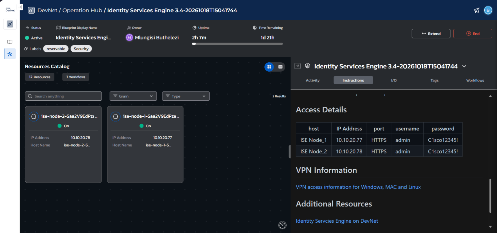
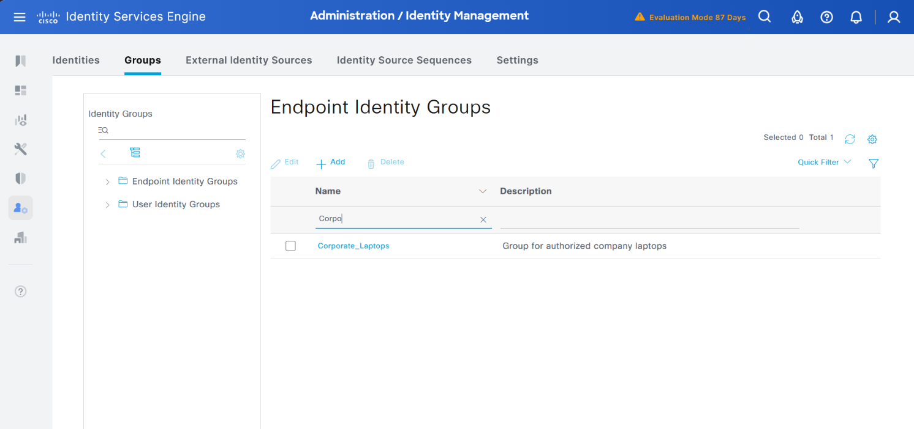
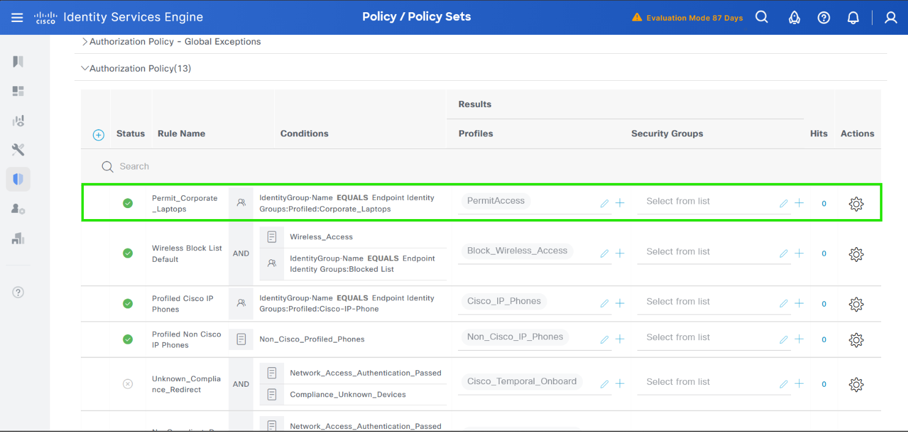

# Enterprise Network Security Architecture: Dynamic 802.1X Access Control & Micro-Segmentation via Cisco ISE

## Project Overview
This project demonstrates the implementation of a centralized **Network Access Control (NAC)** framework utilizing **Cisco Identity Services Engine (ISE) 3.4**. The objective is to enforce the core pillars of the **Zero Trust Network Architecture (ZTNA)** model—"Never Trust, Always Verify"—on an enterprise network entry point. By replacing static port access with dynamic identity-based authentication, this architecture actively prevents unauthorized devices from accessing internal infrastructure assets.

---

## Technical Architecture & Core Configuration

### 1. High Availability (HA) Infrastructure Baseline
In an enterprise production network, a centralized security server represents a single point of failure. This deployment uses a **High Availability (HA)** multi-node cluster consisting of a Primary Administration Node (PAN) and a Secondary node to ensure continuous network uptime and validation redundancy.

* **Primary Node IP:** `10.10.20.77`
* **Secondary Node IP:** `10.10.20.78`

### 2. Asset Classification and Identity Profiling
To achieve micro-segmentation, hardware assets must be bucketed by network roles before security policies are written. A custom **Endpoint Identity Group** was constructed specifically to isolate company-managed systems.

* **Group Built:** `Corporate_Laptops`
* **Engineering Purpose:** Functions as an explicit containment boundary. Devices are assigned to this group based on hardcoded network fingerprints (MAC addresses), separating corporate computers from untrusted guest machines or IoT hardware.

### 3. Zero Trust Policy Decision Engine
Network access is determined dynamically using an **Authorization Policy Set** evaluated top-to-bottom. A custom rule was injected at the highest priority tier (Line 1) to evaluate incoming connections against the new asset database.

* **Rule Name:** `Permit_Corporate_Laptops`
* **Logical Condition (IF):** `IdentityGroup Name EQUALS Endpoint Identity Groups:Profiled:Corporate_Laptops`
* **Authorization Profile (THEN):** `PermitAccess`
* **Execution Logic:** When a device connects to a network switch port, the switch passes the identity to Cisco ISE via the **RADIUS** protocol. If the device matches the corporate group criteria, ISE explicitly pushes a `PermitAccess` result to open that specific port. If it fails to match, it falls through to the default global policy rules where traffic is immediately blocked or isolated.

---

## Compliance & Security Framework Mapping
This lab architecture directly satisfies requirements across major cybersecurity control frameworks:
* **NIST SP 800-207 (Zero Trust Architecture):** Implements automated Policy Decision Points (PDP) to dynamically restrict network access, preventing the lateral movement of malware or unauthorized users within the network infrastructure.
* **CIS Critical Security Controls (Control 3: Data Protection & Control 12: Network Infrastructure Management):** Establishes explicit asset-to-network boundaries, ensuring only documented, authorized endpoints can communicate with enterprise data segments.
* **ISO/IEC 27001 (A.13.1 Network Security Management):** Guarantees networks are appropriately managed and controlled to protect information systems from unauthorized intrusion.
*
